# OOP25-UniBodget — Controller - UML Class Diagram
GitHub renders the diagram below automatically.

```mermaid
classDiagram
    direction TB

    %% ============================================================
    %% ============ CONVERTER & BANK CONTROLLERS ========
    %% ============================================================

    class CurrencyConverterController {
        -CurrencyConverter converter
        -CurrencyAlertService alertService
        -WatchList watchList
        +CurrencyConverterController(CurrencyConverter, CurrencyAlertService, WatchList)
        +convert(BigDecimal, CurrencyUnit, CurrencyUnit) CurrencyConversionResult
        +getAlertService() CurrencyAlertService
        +getWatchList() WatchList
    }

    class BankConversionController {
        -BankConversionService conversionService
        -BankList bankList
        -BasicCurrencyConverter baseConverter
        +BankConversionController(BankConversionService, BasicCurrencyConverter)
        +convertWithBank(Bank, BigDecimal, CurrencyUnit, CurrencyUnit) BankConversionResult
        +getAvailableBanks() List~Bank~
        +addCustomBank(Bank) void
        +removeBank(Bank) void
    }

    class WatchListController {
        -WatchList watchList
        +WatchListController(WatchList)
        +addPair(CurrencyUnit, CurrencyUnit) boolean
        +removePair(WatchlistPair) boolean
        +getWatchedPairs() Set~WatchlistPair~
    }

    class SettingsController {
        -Settings settings
        -SettingsManager settingsManager
        +SettingsController(Settings, SettingsManager)
        +getSettings() Settings
        +changeTheme(Theme) void
        +changeBaseCurrency(CurrencyUnit) void
        +restoreSnapshot(SettingsSnapshot) void
        +getSnapshotHistory() List~SettingsSnapshot~
        +savePreferences() void
    }

    %% ============================================================
    %% ============ MODEL DEPENDENCIES ==================
    %% ============================================================

    class CurrencyConverter {
        <<interface>>
        +convert(BigDecimal, CurrencyUnit, CurrencyUnit) CurrencyConversionResult
    }

    class BankConversionService {
        +convert(Bank, BigDecimal, CurrencyUnit, CurrencyUnit, CurrencyConverter) BankConversionResult
    }

    class CurrencyAlertService {
        +checkAlerts(double, CurrencyUnit, CurrencyUnit) List~CurrencyAlert~
    }

    class WatchList {
        +getPairs() Set~WatchlistPair~
    }

    class SettingsManager {
        +getSettings() Settings
        +saveSettings(Settings) void
    }

    class Settings {
        +createSnapshot() SettingsSnapshot
        +restoreFromSnapshot(SettingsSnapshot) void
    }

    CurrencyConverterController --> CurrencyConverter : delegates
    CurrencyConverterController --> CurrencyAlertService : queries
    CurrencyConverterController --> WatchList : accesses
    BankConversionController --> BankConversionService : delegates
    WatchListController --> WatchList : manages
    SettingsController --> Settings : updates
    SettingsController --> SettingsManager : persists

    %% ============================================================
    %% ============ APPLICATION & DASHBOARD CONTROLLERS ==========
    %% ============================================================

    class BaseViewController {
        <<abstract>>
        #subscribe(Class~T~, Consumer~T~) void
        #unsubscribeAll() void
    }

    class DefaultDashboardController {
        -DashboardView view
        -DashboardFacade facade
        -CashAccountService cashAccountService
        -Settings settings
        +initialize() void
        +handleCreateWallet() void
        +handleDeleteWallet() void
        +handleNewTransaction() void
    }

    class DefaultInvestmentController {
        -InvestmentAccount currentAccount
        +executeBuyOrder(...) OrderResult
        +executeSellOrder(...) OrderResult
    }

    DefaultDashboardController --|> BaseViewController
    DefaultDashboardController --> Settings : observes base currency
```



    %% ============================================================
    %% ============ CONVERTER & BANK CONTROLLERS =================
    %% ============================================================

    class CurrencyConverterController {
        -CurrencyConverter converter
        -CurrencyAlertService alertService
        -WatchList watchList
        +CurrencyConverterController(CurrencyConverter, CurrencyAlertService, WatchList)
        +convert(BigDecimal, CurrencyUnit, CurrencyUnit) CurrencyConversionResult
        +getAlertService() CurrencyAlertService
        +getWatchList() WatchList
    }

    class BankConversionController {
        -BankConversionService conversionService
        -BankList bankList
        -BasicCurrencyConverter baseConverter
        +BankConversionController(BankConversionService, BasicCurrencyConverter)
        +convertWithBank(Bank, BigDecimal, CurrencyUnit, CurrencyUnit) BankConversionResult
        +getAvailableBanks() List~Bank~
        +addCustomBank(Bank) void
        +removeBank(Bank) void
    }

    class WatchListController {
        -WatchList watchList
        +WatchListController(WatchList)
        +addPair(CurrencyUnit, CurrencyUnit) boolean
        +removePair(WatchlistPair) boolean
        +getWatchedPairs() Set~WatchlistPair~
    }

    class SettingsController {
        -Settings settings
        -SettingsManager settingsManager
        +SettingsController(Settings, SettingsManager)
        +getSettings() Settings
        +changeTheme(Theme) void
        +changeBaseCurrency(CurrencyUnit) void
        +restoreSnapshot(SettingsSnapshot) void
        +getSnapshotHistory() List~SettingsSnapshot~
        +savePreferences() void
    }

    %% ============================================================
    %% ============ MODEL DEPENDENCIES ============================
    %% ============================================================

    class CurrencyConverter {
        <<interface>>
        +convert(BigDecimal, CurrencyUnit, CurrencyUnit) CurrencyConversionResult
    }

    class BankConversionService {
        +convert(Bank, BigDecimal, CurrencyUnit, CurrencyUnit, CurrencyConverter) BankConversionResult
    }

    class CurrencyAlertService {
        +checkAlerts(double, CurrencyUnit, CurrencyUnit) List~CurrencyAlert~
    }

    class WatchList {
        +getPairs() Set~WatchlistPair~
    }

    class SettingsManager {
        +getSettings() Settings
        +saveSettings(Settings) void
    }

    class Settings {
        +createSnapshot() SettingsSnapshot
        +restoreFromSnapshot(SettingsSnapshot) void
    }

    CurrencyConverterController --> CurrencyConverter : delegates
    CurrencyConverterController --> CurrencyAlertService : queries
    CurrencyConverterController --> WatchList : accesses
    BankConversionController --> BankConversionService : delegates
    WatchListController --> WatchList : manages
    SettingsController --> Settings : updates
    SettingsController --> SettingsManager : persists

    %% ============================================================
    %% ============ APPLICATION & DASHBOARD CONTROLLERS ==========
    %% ============================================================

    class BaseViewController {
        <<abstract>>
        #subscribe(Class~T~, Consumer~T~) void
        #unsubscribeAll() void
    }

    class DefaultDashboardController {
        -DashboardView view
        -DashboardFacade facade
        -CashAccountService cashAccountService
        -Settings settings
        +initialize() void
        +handleCreateWallet() void
        +handleDeleteWallet() void
        +handleNewTransaction() void
    }

    class DefaultInvestmentController {
        -InvestmentAccount currentAccount
        +executeBuyOrder(...) OrderResult
        +executeSellOrder(...) OrderResult
    }

    DefaultDashboardController --|> BaseViewController
    DefaultDashboardController --> Settings : observes base currency
```

