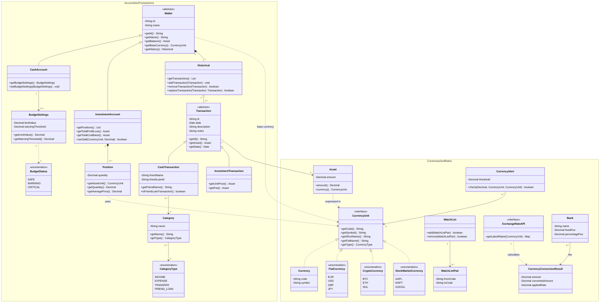

# OOP25-UniBodget — Schema UML del Dominio Completo

Questo documento unifica i due diagrammi di dominio presentati nella relazione:
- **Parte 1:** Conti di liquidità, investimenti, storico transazioni, posizioni e gestione budget (cfr. [uml-dominio-conti.md](uml-dominio-conti.md))
- **Parte 2:** Valute multivaluta, mercati, exchange rates, watchlist e banche (cfr. [uml-dominio-valute.md](uml-dominio-valute.md))

